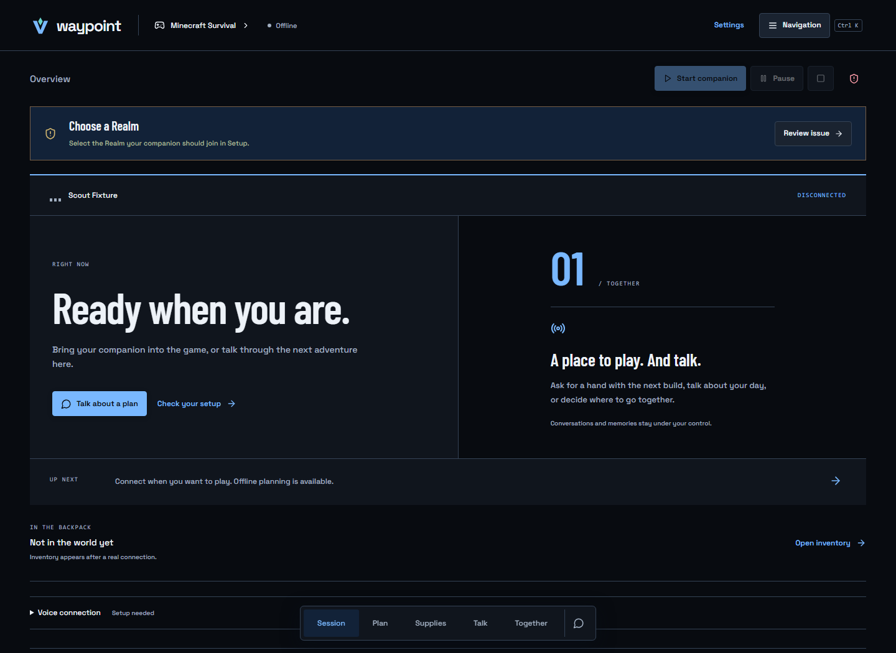

# Player Two

**An AI agent. On your team.**

Player Two is a free, open-source **AI gaming companion platform**: a companion to
play with, talk to, share goals with and improve together. **Minecraft Survival is
the first and only playable integration today.** More games are a community-led
ambition, not announced support. Built on
[Mineness](https://github.com/SpectrumTantrum/mineness), with real planning,
perception, memory, deterministic skills and observable execution.

This is an **experimental prerelease**. The companion is AI, not a human friend;
its personality should make gaming enjoyable without invented experiences,
emotional pressure or claims of unattended human-level gameplay.

[Website](https://alfonza1.github.io/minecraft-companion/) ·
[Get started](docs/INSTALLATION.md) · [Workspace](docs/WORKSPACE.md) · [Architecture](docs/ARCHITECTURE.md) ·
[Contribute](CONTRIBUTING.md) · [Roadmap](docs/ROADMAP.md)


## Play together. Talk naturally. Keep the good bits.

The shared workspace puts your companion, current activity, mission, resources,
help requests and conversation together. Adjust its name, style and talkativeness;
save a real conversation or completed task as a moment; inspect or delete it later.
A visible tool strip opens tasks, inventory, resources, building and teamwork
directly. Session keeps activity, carried items and chat together. **More tools**
or **Ctrl+K** (or **⌘K**) opens secondary tools. Gathering, construction, exploration and blockers each
bring different information forward. No friendship scores, fabricated memories
or fake live telemetry.



This is an actual application screenshot from a disconnected test session. It is
not evidence of successful live gameplay. See the
[workspace guide](docs/WORKSPACE.md) for the authoritative state behind each view.

## Run it locally

Install Git and Node.js 24 LTS, then:

```text
git clone --branch feat/minecraft-companion --recurse-submodules https://github.com/alfonza1/minecraft-companion.git
cd minecraft-companion
npm run install:agent
npm start
```

Open **http://127.0.0.1:4365 → More tools → Setup**. Minecraft Survival is the supported game. Select an installed local Ollama model for
no-subscription inference, or configure an existing supported provider account.
Connect a separate licensed Minecraft Java account through Microsoft's device-code
flow. Choose its invited Realm and check compatibility before joining.

Windows is the primary supported target. macOS/Linux browser planning is
experimental; secure Realm token persistence and native global voice currently
require Windows. No signed standalone installer is available yet.
[Complete installation and updates](docs/INSTALLATION.md).

## What works

- Event-driven plans with strict action schemas, one-body ownership, pause/stop gates
  and temporary-task interruption/resume.
- A game-aware workspace with actual activity, mission steps, inventory slots,
  raw/finished resource views, shared responsibilities and persistent help requests.
- Timestamped observations, source-backed saved moments, optional memory context,
  approved chest records, resource reservations and project checkpoints.
- Bounded gathering, hunting/food preparation, basic gear upkeep and surface iron
  trips that obtain their own ordinary prerequisites.
- Blueprint import, permitted reference analysis, 3D preview, exact counts for the
  saved design, shared resource assignments and approved survival construction.
- Local speech on Windows; Codex, Claude Code, OpenCode and local Ollama adapters.
- Companion modes that change real background-work behavior, plus adjustable
  conversation style, talkativeness and optional milestone notices.
- A separate static website, developer guides, tested game-observation adapters,
  trusted observation extensions and reproducible evaluation commands.

Video reconstruction can miss hidden blocks. Deep cave/branch mining, unrestricted
building, general multi-agent teams and other playable games are not
implemented. [Full capabilities and limitations](docs/CAPABILITIES.md).

The game registry includes a concrete Minecraft adapter and a **non-playable,
test-only strategy fixture**. This validates workspace extensibility, not a second
game client. [Adapter guide](docs/GAME-ADAPTERS.md).

## Architecture

```text
Human goal / voice → intent routing → bounded context + model plan
                                     ↓
SQLite memory ← checkpoints ← validated actions → single-body runtime
                                     ↓
Shared workspace ← game observation adapter ← Mineflayer ←→ Minecraft Java
```

Fast reflexes and deterministic skill execution do not need a model call per step.
General conversation cannot invoke game tools. The public website never connects
to a private companion API. Minecraft execution remains game-specific; adding a
future game requires a legitimate connection, actions and safety tests.
[Technical walkthrough](docs/ARCHITECTURE.md).

## Development and verification

```text
npm test
npm run typecheck
npm run build
npm run build:website
npm run test:website
npm run evaluate
npm run release:check
```

The evaluation report distinguishes contract doubles from actual survival fixtures.
There is no invented model leaderboard, billing cost or broad task success rate.
[Methodology](docs/EVALUATION.md) · [API](docs/API.md) ·
[Extension guide](docs/EXTENSIONS.md) · [Troubleshooting](docs/TROUBLESHOOTING.md) ·
[Personality and memory](docs/COMPANION-PERSONALITY.md) ·
[Detailed companion guide](docs/COMPANION-GUIDE.md).

## Build the next world with us

Players can report a confusing blocker, test a small shared objective or propose a
game. Developers can add observation modules, improve recovery, validate a building
state or research a permitted game integration. No fabricated voting, contributor
counts or delivery dates. [Contribution paths](CONTRIBUTING.md) and the
[community roadmap](docs/ROADMAP.md) describe the useful work ahead.

## Free software, clear costs

Source is **Apache-2.0**, with original LICENSE/NOTICE retained. No ads, license
keys or paid feature unlocks. Minecraft, a separate bot account, Realm hosting and
optional external model providers are not included. Local model weights have their
own licenses and hardware requirements. Optional cloud requests can incur charges.

State and credentials stay outside the repository. Selected hosted providers
receive request context; media sharing is explicit. Never publish database backups
or tokens. See [Security](SECURITY.md) and [license/advisory review](docs/RELEASE-SECURITY.md).

Independent project, not affiliated with Mojang or Microsoft. Player Two is a project
identity, not a claim of registered trademark rights.
