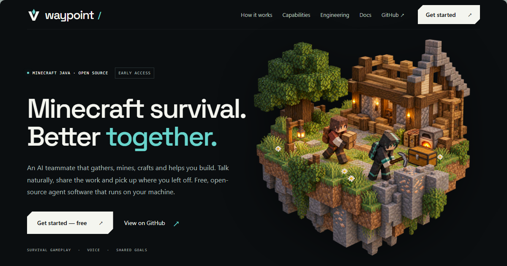

# Waypoint

**Your AI Minecraft survival teammate — powered by an open-source autonomous agent runtime.**

Minecraft Companion is the first environment: a local teammate with structured
planning, deterministic skills, persistent tasks, observable execution and human
collaboration. Built on [Mineness](https://github.com/SpectrumTantrum/mineness).
This is an **experimental prerelease**, not unattended human-level gameplay.

[Website](https://alfonza1.github.io/minecraft-companion/) ·
[Get started](docs/INSTALLATION.md) · [Architecture](docs/ARCHITECTURE.md) ·
[Contribute](CONTRIBUTING.md) · [Roadmap](docs/ROADMAP.md)



## Run it locally

Install Git and Node.js 24 LTS, then:

```text
git clone --branch feat/minecraft-companion --recurse-submodules https://github.com/alfonza1/minecraft-companion.git
cd minecraft-companion
npm run install:agent
npm start
```

Open **http://127.0.0.1:4365 → Setup**. Select an installed local Ollama model for
no-subscription inference, or configure an existing supported provider account.
Connect a separate licensed Minecraft Java account through Microsoft's device-code
flow. Choose its invited Realm and check compatibility before joining.

Windows is the primary supported target. macOS/Linux browser planning is
experimental; secure Realm token persistence and native global voice currently
require Windows. No signed standalone installer is available yet.
[Complete installation and updates](docs/INSTALLATION.md).

## What works

- Event-driven plans with strict action schemas, one-body ownership, pause/stop gates
  and temporary-task interruption/resume.
- Actual observed inventory, timestamped state, saved notes, approved chest memory,
  resource reservations and project checkpoints.
- Bounded gathering, hunting/food preparation, basic gear upkeep and surface iron
  trips that obtain their own ordinary prerequisites.
- Blueprint import, permitted reference analysis, 3D preview, exact counts for the
  saved design, shared resource assignments and approved survival construction.
- Local speech on Windows; Codex, Claude Code, OpenCode and local Ollama adapters.
- A separate static website, developer guides, tested observation extensions and
  reproducible evaluation commands.

Video reconstruction can miss hidden blocks. Deep cave/branch mining, unrestricted
building, general multi-agent teams and other execution environments are not
implemented. [Full capabilities and limitations](docs/CAPABILITIES.md).

## Architecture

```text
Human goal / voice → intent routing → bounded context + model plan
                                     ↓
SQLite memory ← checkpoints ← validated actions → single-body runtime
                                     ↓
Dashboard ← observed events ← Mineflayer ←→ Minecraft Java
```

Fast reflexes and deterministic skill execution do not need a model call per step.
General conversation cannot invoke game tools. The public website never connects
to a private companion API. [Technical walkthrough](docs/ARCHITECTURE.md).

## Development and verification

```text
npm test
npm run typecheck
npm run build
npm run build:website
npm run test:website
npm run evaluate
npm run release:check
```

The evaluation report distinguishes contract doubles from actual survival fixtures.
There is no invented model leaderboard, billing cost or broad task success rate.
[Methodology](docs/EVALUATION.md) · [API](docs/API.md) ·
[Extension guide](docs/EXTENSIONS.md) · [Troubleshooting](docs/TROUBLESHOOTING.md) ·
[Detailed companion guide](docs/COMPANION-GUIDE.md).

## Free software, clear costs

Source is **Apache-2.0**, with original LICENSE/NOTICE retained. No ads, license
keys or paid feature unlocks. Minecraft, a separate bot account, Realm hosting and
optional external model providers are not included. Local model weights have their
own licenses and hardware requirements. Optional cloud requests can incur charges.

State and credentials stay outside the repository. Selected hosted providers
receive request context; media sharing is explicit. Never publish database backups
or tokens. See [Security](SECURITY.md) and [license/advisory review](docs/RELEASE-SECURITY.md).

Independent project, not affiliated with Mojang or Microsoft. Waypoint is a project
identity, not a claim of registered trademark rights.
