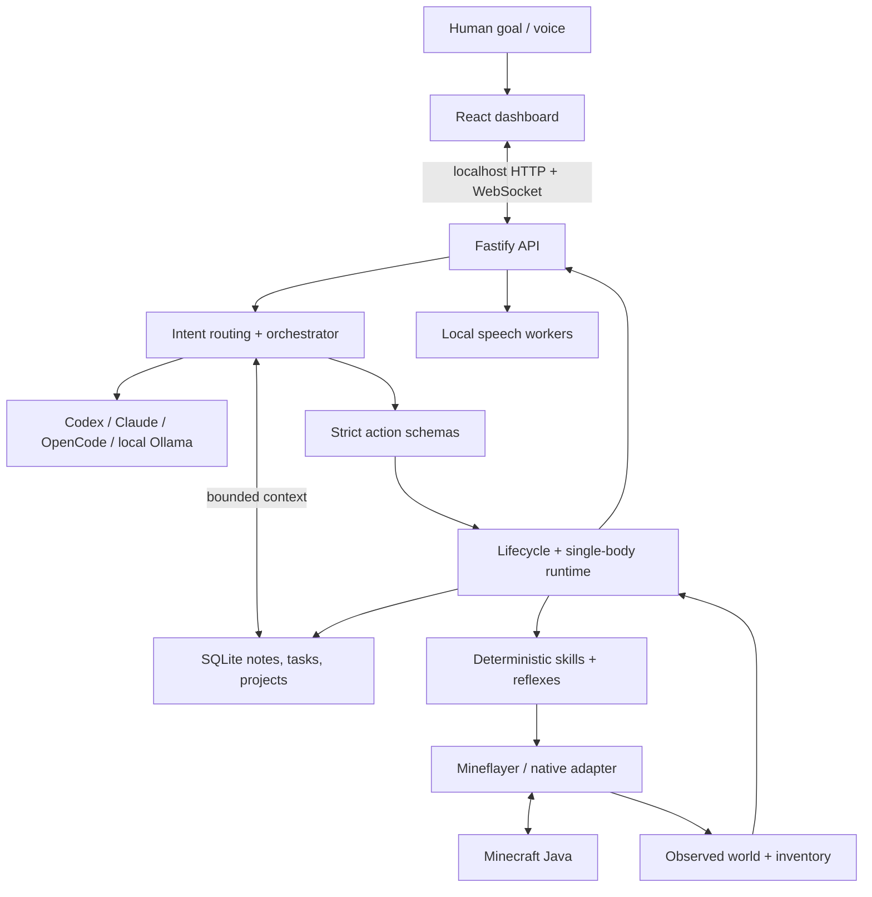

# Architecture

Waypoint is an agent platform identity over the existing Minecraft Companion
runtime. It is not yet a general-purpose multi-environment framework.
One backend owns one body. The installed app name and data folder remain stable.

## Actual responsibilities

| Module | Responsibility |
| --- | --- |
| apps/dashboard | Real runtime controls, inventory, tasks, build studio, settings |
| apps/website | Independent prerendered static public site, no private API client |
| services/api | Loopback boundary, validated HTTP routes, snapshots and WebSockets |
| services/agent-orchestrator | Intent, bounded context, structured plans, task stack |
| services/companion-runtime | One body, lifecycle, operation ownership, reflexes |
| services/realm-connector | Device-code auth, Realm selection, version and reconnect |
| services/world-state | Timestamped observations, inventory exactness, nearby entities |
| services/skill-executor | Navigation, collection, cooking, gear, storage, iron trips |
| services/build-planner | Blueprint validation and recipe-derived material plan |
| services/build-executor | Approved survival placement, supplies, verification/checkpoints |
| services/resource-ledger | Splits, reservations, reported/observed progress |
| services/reference-ingestion | Bounded imports, media evidence and supported provider routes |
| services/memory | Local SQLite document store and backups |
| packages/agent-extensions | Versioned trusted observation contract |
| src | Preserved upstream MCP and reusable gameplay plumbing |

## Request lifecycle

Common anchored commands use deterministic quick plans. Other explicit messages
call the chosen model with bounded recent conversation, relevant notes and current
observations. Models return structured output. validatePlan rejects unsupported
tools, invalid arguments and actions attached to non-action conversation.
Plans contain at most six actions. The runtime rechecks permission and actual state
at execution time; a model cannot approve a blueprint or mining zone.

The planner is event-driven, not an endless polling loop. Optional idle work uses
bounded deterministic approved skills. General conversation can coexist with safe
gameplay; physical jobs remain serialized.

## State and recovery

SQLite records tasks, project revisions, approval hashes, reservations, chest
observations, saved task stacks and construction/mining checkpoints. It does not
store a complete authoritative world map. Chest data is historical until observed
again. Human inventory contributions are explicitly user-reported.

Pause first closes action/model admission gates, then cancels workers and jobs.
Pending library operations remain owned until settled. Resume never overlaps a
still-stopping job. Stop disconnects and clears queued task intent while preserving
project data. Reconnection uses bounded retries and returns paused.

A completed action is not automatically a completed goal. Inventory transfer and
construction checkpoints use server-confirmed results. Unloaded regions remain
unverified. Safety controllers are initial heuristics, not survival guarantees.

## Memory and model privacy

The store is structured local memory, not a vector database. Recent context and
relevant explicit notes are selected; low-token mode reduces those bounds.
Automatic historical conversation summarization is not implemented. Users can
inspect/add/delete notes; full edit/import remains limited.

Providers receive the request context, never arbitrary shell access. The public
UI shows observable execution summaries, errors, model identity and reported token
usage. It does not display hidden model reasoning. Reported tokens are distinct
from unknown account quotas or billing costs.

## Extension boundaries

Observation modules receive cloned snapshots and validated input/output. They are
statically installed trusted code; no dynamic plugin marketplace or sandbox exists.
New gameplay tools require schemas, runtime integration, permissions, cancellation
and real gameplay tests. Minecraft assumptions still live in planner/tool schemas;
a second environment will require a real adapter, not merely a renamed interface.
