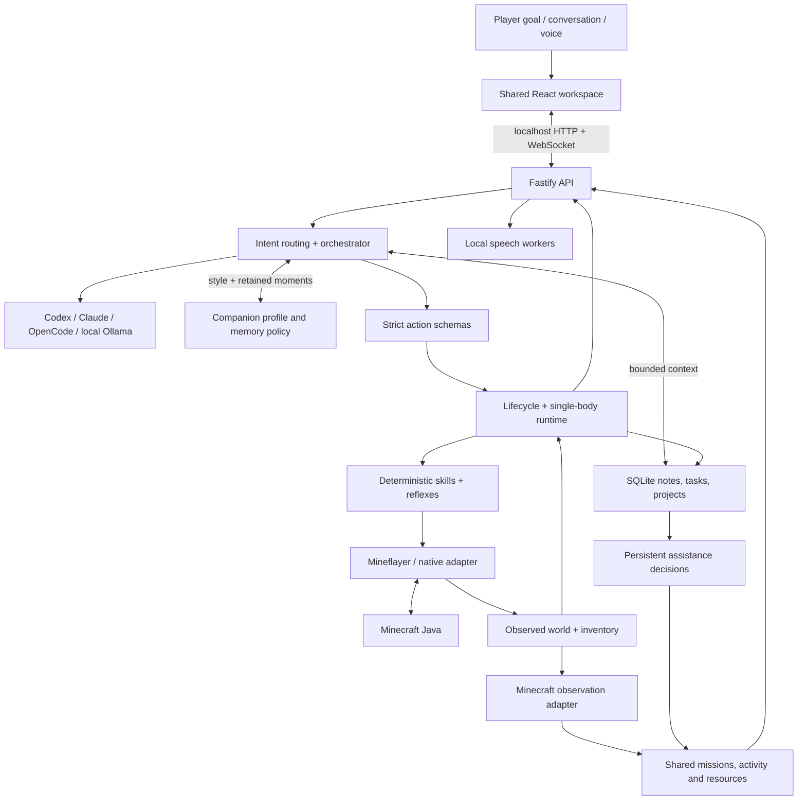

# Architecture

Waypoint is an AI gaming companion platform with Minecraft Survival as its first
and only playable environment. It separates shared workspace observations from
game-specific execution without pretending the entire runtime is already generic.
One backend owns one body. The installed app name and data folder remain stable.

## Actual responsibilities

| Module | Responsibility |
| --- | --- |
| apps/dashboard | Shared companion workspace; Minecraft inventory/build widgets |
| apps/website | Independent prerendered static public site, no private API client |
| services/api | Loopback boundary, validated HTTP routes, snapshots and WebSockets |
| services/agent-orchestrator | Intent, bounded context, structured plans, task stack |
| services/companion-runtime | One body, lifecycle, operation ownership, reflexes |
| services/realm-connector | Device-code auth, Realm selection, version and reconnect |
| services/world-state | Timestamped observations, inventory exactness, nearby entities |
| services/skill-executor | Navigation, collection, cooking, gear, storage, iron trips |
| services/build-planner | Blueprint validation and recipe-derived material plan |
| services/build-executor | Approved survival placement, supplies, verification/checkpoints |
| services/resource-ledger | Splits, reservations, reported/observed progress |
| services/reference-ingestion | Bounded imports, media evidence and supported provider routes |
| services/memory | Local SQLite document store and backups |
| services/workspace | Authoritative projection, persistent assistance, task-control routes |
| services/companion-personality | Profile, real mode changes, source-backed moments and prompt context |
| packages/game-adapters | Descriptor registry and normalized game observations |
| packages/agent-extensions | Versioned trusted observation contract |
| src | Preserved upstream MCP and reusable gameplay plumbing |

## Request lifecycle

Common anchored commands use deterministic quick plans. Other explicit messages
call the chosen model with bounded recent conversation, relevant notes and current
observations. Models return structured output. validatePlan rejects unsupported
tools, invalid arguments and actions attached to non-action conversation.
Plans contain at most six actions. The runtime rechecks permission and actual state
at execution time; a model cannot approve a blueprint or mining zone.

The planner is event-driven, not an endless polling loop. Optional idle work uses
bounded deterministic approved skills. General conversation can coexist with safe
gameplay; physical jobs remain serialized.

Explicit mode phrases use a deterministic handler. Choosing Hangout or Teammate
stops background chores without canceling an explicit task. Adventure prefers
bounded surface scouting after safety/supply prerequisites; Autonomous uses the
existing approved common-supply routines. None grants new permissions or starts
an endless strategic-model loop. See [personality](COMPANION-PERSONALITY.md).

## State and recovery

SQLite records tasks, project revisions, approval hashes, reservations, chest
observations, saved task stacks and construction/mining checkpoints. It does not
store a complete authoritative world map. Chest data is historical until observed
again. Human inventory contributions are explicitly user-reported.

Pause first closes action/model admission gates, then cancels workers and jobs.
Pending library operations remain owned until settled. Resume never overlaps a
still-stopping job. Stop disconnects and clears queued task intent while preserving
project data. Reconnection uses bounded retries and returns paused.

A completed action is not automatically a completed goal. Inventory transfer and
construction checkpoints use server-confirmed results. Unloaded regions remain
unverified. Safety controllers are initial heuristics, not survival guarantees.

## Memory and model privacy

The store is structured local memory, not a vector database. Recent context and
relevant explicit notes are selected; low-token mode reduces those bounds.
Automatic historical conversation summarization is not implemented. Users can
inspect/add/delete notes; full edit/import remains limited. Companion moments
reference an existing conversation, completed task or completed project. A saved
quote is evidence of what was said, not proof that a gameplay event happened.
Disabling companion memory excludes saved notes and moments from conversation
context and blocks new moments; it does not erase current conversation, active
work, Home coordinates or permissions required for safe operation.

Providers receive the request context, never arbitrary shell access. The public
UI shows observable execution summaries, errors, model identity and reported token
usage. It does not display hidden model reasoning. Reported tokens are distinct
from unknown account quotas or billing costs.

## Extension boundaries

Observation modules receive cloned snapshots and validated input/output. They are
statically installed trusted code; no dynamic plugin marketplace or sandbox exists.
New gameplay tools require schemas, runtime integration, permissions, cancellation
and real gameplay tests. Minecraft assumptions still live in planner/tool schemas;
a second playable game will require a real action adapter, not merely a renamed interface.

`packages/game-adapters` validates game descriptors and projects cloned observations
into shared session, activity, mission, resource and assistance contracts. The
production registry contains only Minecraft Survival. A non-playable strategy
fixture checks a different resource shape; it is not selectable in production.
Descriptors list widget identifiers, capabilities, action names and requirements.
They do not confer permission to execute those actions. The Minecraft action
schemas, protocol connection, crafting and navigation remain game-specific.
[Game adapter contract and example](GAME-ADAPTERS.md).

## Workspace accounting and assistance

The API continues to publish complete authoritative snapshots over WebSockets.
The client restores that snapshot after reconnect instead of replaying optimistic
local progress. Observation timestamps and transport status identify stale data.

Resource rows distinguish carried items, reservations, historical chest snapshots,
reported player contributions and verified construction coverage. Raw ingredients
and finished building items are alternative views, never additive totals. Verified
placements remain counted after inventory is consumed. Blueprint revisions reset
their applicability; unloaded world changes cannot be assumed absent.

Stable source IDs deduplicate assistance requests. Decisions persist in SQLite,
and revisions reject conflicting or stale updates. Accepting a request assigns
responsibility, not delivery credit. Companion responses submit supported work
through the same task stack. Changing the plan holds work and awaits instructions;
it does not silently invoke a model. See [workspace behavior](WORKSPACE.md).
